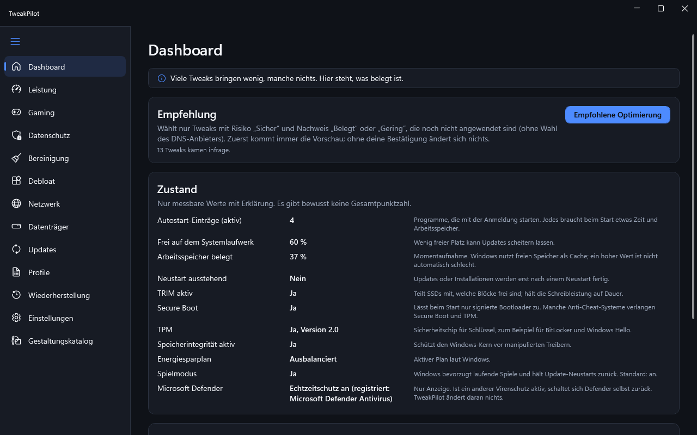

# TweakPilot

Open-source Windows tuning that previews every change and can undo everything.

- **Undo everything.** Every change is backed up first and can be reset with one click.
- **No telemetry.** The app sends nothing. It only goes online when you click "Check for updates".
- **Open source.** Every tweak names its source, so you can check what it does.



## Download

Get the latest ZIP from [GitHub Releases](https://github.com/TweakPilot/TweakPilot/releases/latest).

1. Download `TweakPilot-<version>-win-x64.zip` and `SHA256SUMS.txt`.
2. Check the file (PowerShell): `Get-FileHash .\TweakPilot-<version>-win-x64.zip -Algorithm SHA256`.
   The hash must match the line in `SHA256SUMS.txt`.
3. Unzip, open the `TweakPilot` folder and start `TweakPilot.exe`. `START HERE.txt` explains install, reset and removal.

Requirements: Windows 10 22H2 (build 19045) or Windows 11, 64-bit.

## Why does Windows warn me?

The files are not code-signed yet, so SmartScreen may show "Windows protected your PC". Check the hash as shown above.
You can also verify that the ZIP was built from this repository:

```
gh attestation verify TweakPilot-<version>-win-x64.zip --repo TweakPilot/TweakPilot
```

Do not turn off Microsoft Defender or SmartScreen for this or any other app.

## What it does not do

TweakPilot never turns off Defender, the firewall, UAC, SmartScreen or Windows Update. Deleted files and removed apps
cannot always be restored; the app says so before you confirm.

## Build

Requires the .NET 8 SDK (see `global.json`).

```
dotnet build
powershell -NoProfile -ExecutionPolicy RemoteSigned -File build.ps1
```

`build.ps1` is the quality gate (build without warnings, tests, catalog lint, contrast and format checks, package test).
`build.ps1 -Package` builds the finished folder and the ZIP. Details: `docs/BUILD.md`.

## Command line

```
tweakpilot-cli --list [--module PRIV] [--json]
tweakpilot-cli --apply PRIV-001,PRIV-013 [--dry-run]
tweakpilot-cli --revert PRIV-001 | --revert-all
```

## License

MIT, see [LICENSE](LICENSE).

Not affiliated with Microsoft or any game publisher.
